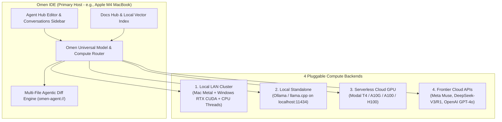

# Omen (`omni-io`)

**Modular Agentic AI IDE & Hybrid Compute Orchestrator**

Omen is a custom, AI-native integrated development environment forked from `Code - OSS` (`v1.144.0`). It is engineered to eliminate single-machine hardware bottlenecks, remove mandatory cloud lock-in, and unify multi-file agentic code synthesis with distributed local and cloud compute orchestration.

---

## Key Capabilities

* **Cross-Platform LAN Hardware & VRAM Pooling** — Aggregate Apple Metal, NVIDIA CUDA, and multi-device CPU threads across local machines via a zero-install 4-digit PIN Web Pairing Portal.
* **Pluggable Multi-Backend Compute Architecture** — Hot-swap per session between local clusters, standalone Ollama daemons, serverless cloud GPUs (Modal), and frontier APIs.
* **Native Multi-File Agentic Diff Engine** — Scope agents to any workspace directory, preview multi-file edits in a unified/side-by-side diff viewer, and apply or revert changes atomically.
* **Native Meta Muse & Extended Context Integration** — First-class support for Meta’s frontier reasoning suite (`muse-spark-1.3`, `muse-wonder`, `llama-3.3-70b-instruct`) alongside DeepSeek and OpenAI, supporting context windows up to 1,000,000 tokens.
* **Modular Local-First Document RAG & Context Meter** — Index project documentation and PDFs locally using lightweight embeddings (`nomic-embed-text`, `bge-m3`) with real-time token and KV-cache telemetry.

---

## System Architecture: How Omen Works



### 1. The 4 Pluggable Compute Backends

Every agent session in Omen can be routed to any of four execution backends at any time:

| Backend | Execution Mechanism | Primary Use Case |
| :--- | :--- | :--- |
| **1. Local Multi-Device Cluster (LAN)** | Pools GPU VRAM and CPU threads across the primary workstation (e.g., Apple M4) and secondary worker nodes (e.g., Windows laptop with NVIDIA RTX 3050) over Wi-Fi/Ethernet. | Running larger quantized models (14B–32B) and accelerating prompt ingestion 100% offline. |
| **2. Local Standalone (Ollama)** | Connects directly to the local Ollama REST daemon (`http://localhost:11434`) to discover, pull, and stream local `.gguf` models. | Zero-setup offline coding on a single laptop (`qwen2.5-coder:7b`, `llama3.1:8b`). |
| **3. Serverless Cloud GPU (Modal)** | Provisions ephemeral GPU containers (NVIDIA T4, A10G, A100, H100) via Modal on demand and scales to `$0` when idle. | Heavy 70B+ open-weight inference or batch codebase indexing without owning dedicated server hardware. |
| **4. External AI APIs (BYOK)** | Streams requests over HTTPS to OpenAI-compatible endpoints with keys stored in the OS native keychain (`context.secrets`). | Instant access to `muse-spark-1.3`, `muse-wonder`, `deepseek-chat`, `deepseek-reasoner`, and `gpt-4o`. |

---

### 2. Multi-Device LAN Clustering (3-Step Web Pairing)

Omen turns idle secondary laptops or desktops into distributed inference workers without manual SSH or environment setup:

1. **Start Cluster Host**: Open the **LAN Compute** view in Omen. Omen starts a pairing listener (`http://<Host-LAN-IP>:50050`) and generates a **4-digit PIN**.
2. **Pair Secondary Node**: Open the pairing URL in a browser on the secondary machine, enter the 4-digit PIN, and launch the lightweight worker binary (`omen-worker.exe`).
3. **Pool Hardware**: Omen automatically distributes transformer layers across combined GPU memory (Metal + CUDA) and balances tokenization/AST worker threads across both CPUs.

---

### 3. Multi-File Agentic Diff Workflow

Implemented in [`extensions/omen-models/src/agentHubEditor.ts`](extensions/omen-models/src/agentHubEditor.ts) and [`extensions/omen-models/src/agentDiffManager.ts`](extensions/omen-models/src/agentDiffManager.ts):

1. **Workspace & Subfolder Targeting**: Select any root repository or subfolder directly from the Agent Hub header.
2. **Contextual Prompting**: Attach specific workspace files (`@file`) or local documentation collections (`@docs`).
3. **Sandboxed Virtual Diffs**: When the agent proposes multi-file edits, Omen stages the modifications in memory using the `omen-agent://` virtual document scheme rather than overwriting files immediately.
4. **Transactional Review**: Inspect line-by-line additions and deletions in the inline unified diff card or full VS Code diff editor, then click **Accept** to write changes to disk or **Reject** to discard them.

---

## Getting Started

### Prerequisites
* **Node.js**: `>= 22.x`
* **Python**: `>= 3.11` (for native node-gyp modules)
* **Rust / Cargo**: Required if building the native CLI shim
* **Optional**: [Ollama](https://ollama.com) installed locally for standalone offline models

### 1. Clone & Install Dependencies

```bash
git clone https://github.com/louwis-alfred/omni-io.git omen
cd omen
npm install
```

### 2. Compile the Built-In Omen Extension

```bash
cd extensions/omen-models
npm run compile
cd ../..
```

### 3. Launch Omen in Development Mode

```bash
# Start the background incremental watcher
npm run watch

# In a second terminal, launch the Omen desktop application
./scripts/code.sh
```

---

## Configuring Models in Omen

### Option A: Frontier Cloud APIs (Meta Muse, DeepSeek, OpenAI)
1. Open the Command Palette (`Cmd + Shift + P` on macOS / `Ctrl + Shift + P` on Windows & Linux).
2. Run **`Omen: Set API Key (Meta Muse / DeepSeek / OpenAI)`** (or open **Omen Settings** from the Agent Hub).
3. Select your provider (`Meta Muse`, `DeepSeek`, or `OpenAI`) and paste your API key. Keys are stored in your OS keychain.

### Option B: Local Models via Ollama
1. Start your local daemon:
   ```bash
   ollama serve
   ```
2. In Omen, run **`Omen: Manage & Download Local Models (Ollama)`** from the Command Palette or click **`$(sparkle) Omen Models`** in the status bar.
3. Choose a preset (`qwen2.5-coder:7b`, `llama3.1:8b`, `deepseek-r1:8b`) to download weights with live progress inside the editor.

---

## Repository Structure

| Path | Description |
| :--- | :--- |
| [`product.json`](product.json) | Omen application branding, bundle identifiers (`com.omen.editor`), and default configuration. |
| [`extensions/omen-models/`](extensions/omen-models/) | Core Omen AI extension: Agent Hub Editor, Multi-File Diff Manager, LAN Cluster View, Docs Hub, Secret Manager, and Universal Model Provider. |
| [`extensions/theme-defaults/themes/omen_dark.json`](extensions/theme-defaults/themes/omen_dark.json) | Custom low-contrast **Omen Dark** color theme and diff editor palette. |
| [`src/vs/workbench/`](src/vs/workbench/) | Customized workbench layout, title bar command center, and native chat/composer services. |

---

## License

Licensed under the [MIT License](LICENSE.txt).
